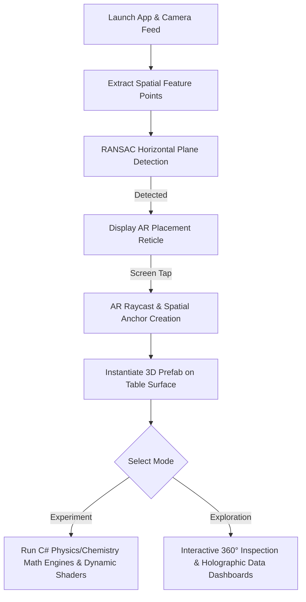

# V-Lab AR: A Modular Augmented Reality Framework for Multi-Disciplinary Science Education

[-green?logo=android)](https://developers.google.com/ar)

**V-Lab AR** is an interactive mobile Augmented Reality application engineered using **Unity** and **Google ARCore** (via Unity AR Foundation). It transforms everyday flat surfaces into safe, cost-effective, and fully interactive physics and chemistry laboratories using marker-less spatial tracking.

---

## 📌 Problem & Motivation

Practical experimentation is a cornerstone of STEM education. However, schools and universities in resource-constrained regions frequently encounter barriers such as:
- **High operational costs:** Continuous procurement of consumable chemical reagents and delicate electrical apparatus.
- **Safety hazards:** Inherent risks of handling open flames, toxic substances, and high currents.
- **Infrastructural limits:** Severe spatial constraints in standard, crowded classrooms.

**V-Lab AR** bypasses dedicated physical infrastructure by leveraging consumer smartphones. Through sensor fusion (camera feed + IMU sensors), it provides real-time, interactive 3D simulations driven by actual physical and stoichiometric equations rather than static animations.

---

## ✨ Key Features & Curriculum

The framework encompasses **8 practical modules** categorized across three suites:

### 🧪 1. Chemistry Suite
- **Acid-Base Titration (HCl + NaOH & Vinegar Acidity):** Interactive burette slider with drop-by-drop fluid dispensing, dynamic pH calculation engine, and real-time shader transitions (phenolphthalein indicator endpoint). Includes an automated results panel for calculating molarity.
- **Flame Emission Spectroscopy:** Virtual Bunsen burner ignition with realistic particle systems rendering spectral emission colors (e.g., Lithium crimson red, Copper blue-green) and unknown salt identification quizzes.
- **Qualitative Radical Tests:** Single displacement and precipitation tests for metallic cations ($\text{Pb}^{2+}$, $\text{Cu}^{2+}$, $\text{Fe}^{2+}$) with floating reaction dashboards.

### ⚡ 2. Physics Suite
- **Ohm's Law ($V = IR$):** DC circuit breadboard assembly where adjusting voltage sliders on virtual power supplies dynamically recalculates currents across resistors and updates live digital multimeters.
- **Kirchhoff's Voltage Law (KVL):** Multi-loop series circuit construction with interactive port wiring, real-time closed-loop validation, and procedural scatter-plot generation from logged voltages.

### 🪐 3. Exploration Suite
- **Interactive 3D Periodic Table:** Full periodic table model with an isolated atomic viewer displaying orbiting electron shells, protons, neutrons, and physical properties.
- **AR Molecule Explorer:** 27 molecular structures across 4 categories featuring CPK standardized atom color-coding.
- **3D Solar System:** Scaled celestial mechanics simulation with surface gravity, mass, and escape velocity holographic dashboards.
- **Biological Anatomy:** 9 anatomical systems (skeletal, muscular, circulatory, etc.) and 10 organs (brain, heart ,etc.) with 360-degree rotation and floating anatomical markers.

---

## 🛠️ Architecture & Technical Stack

- **Game Engine:** Unity (URP - Universal Render Pipeline)
- **Spatial Tracking Engine:** Unity AR Foundation & Google ARCore
- **Tracking Algorithm:** Visual-Inertial Odometry (VIO) using Extended Kalman Filtering (EKF)
- **Plane Detection:** Random Sample Consensus (RANSAC) with Convex Hull polygon boundaries
- **Spatial Persistence:** AR Spatial Anchoring (offsets loop-closure drift)
- **Mobile Optimization:** Mesh decimation (low-poly topology) and Texture Atlas batching (static/dynamic draw call reduction)
- **UI Architecture:** Unity UI Toolkit responsive dashboards & holographic world-space canvases

---

## 📱 How It Works (System Workflow)

---

## 📥 Installation

### 1. Download the App
You can download the compiled Android application directly from the GitHub Releases page:

**👉 [Download V-Lab AR (APK)](https://github.com/KhaingHsuYee/V-Lab-AR-A-Modular-Augmented-Reality-Science-Framework/releases/download/v1.0.0/VLab_AR_final_version.apk)**

### 📱 Scan to Download
If you are viewing this on a computer, simply scan this QR code with your Android phone's camera to download the `.apk` file directly to your mobile device:

  

---

### ⚙️ System Requirements
- **Operating System:** Android 8.0 (Oreo) or higher.
- **Hardware Compatibility:** Must be an [ARCore-supported device](https://developers.google.com/ar/devices).
- **Permissions:** Camera access is strictly required for marker-less spatial tracking.

---

### 🔧 How to Install on Android
Since this app is hosted on GitHub rather than the Google Play Store, you will need to install the APK manually:
1. Download the `.apk` file using the link or QR code above.
2. Open the downloaded file from your phone's notifications or **Downloads** folder.
3. If prompted by Android security, click **Settings** and toggle on **"Allow from this source"** (Install unknown apps).
4. Tap **Install** and wait for the process to finish.
5. Launch **V-Lab AR**, grant the requested camera permissions, and begin scanning your environment!

---

